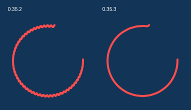

# Проверка Snipcast 0.35.3

Дата: 2026-10-08. Windows/WebView2; отдельные `SNIPCAST_DATA_DIR` и identifier `com.snipcast.selection-qa`. Пользовательский экземпляр приложения, его настройки и закрепы сохранены. Незакоммиченные изменения не сбрасывались. GitHub Release не публиковался.

## Дополнение: иконки фигур в светлой теме

В дополнительной пересборке 0.35.3 исправлены только CSS-цвета кнопок выбора фигур. Ранее в светлой теме применялись светло-серый и белый из тёмной темы. Теперь обычные иконки имеют цвет `#2c3544`, выбранные и наведённые — `#31409e`; фон наведения использует существующий акцент.

Проверены все четыре фигуры, обычное/выбранное/наведённое состояния, обе темы, захват и редактор закрепа. Повторены браузерные `capture_0351.py` и `pin_annotation.py`; отдельно проверен нативный Windows/WebView2 с frontend из Vite и изолированными настройками. [Снимок панели](qa-artifacts/shape-contrast-native/pin-light.png), [полный рабочий стол](qa-artifacts/shape-contrast-native/pin-light-desktop.png), [браузерные результаты](qa-artifacts/shape-contrast/results.json). Официальный exe и `dist` пересобраны, SHA-256 обновлён. Полные проверки геометрии и производительности ниже относятся к сборке перед этой дополнительной правкой цветов.

## Воспроизведение и полная проверка закрепа

На release 0.35.2 воспроизведена светлая системная полоса «Snipcast» над изображением. При этом `WS_CAPTION` отсутствовал (`style=0x14000000`), parent HWND был нулевым, client offset — `(0,0)`, размеры client и window совпадали. Поэтому снятие флагов и прежний тест нескольких верхних рядов не доказывали исправление.

Перед исправлением выполнены создание, фокус, hide/show, масштабирование, принудительный `RedrawWindow`/`WM_NCPAINT`/`WM_NCACTIVATE`, 20 циклов редактора с обеими темами и ещё 3 цикла второго закрепа. Полоса зафиксирована в полном снимке оконной области с окружением на статичном контрастном фоне. Начальное и повторно показанное окна расходились с ожидаемой композицией в **15 824 пикселях**. При переходе в редактор или масштабировании дефект мог исчезать: это объясняет, почему часть прежних проверок проходила.

- [0.35.2: полный снимок с полосой](../dist-release/pin-reopen-0353-before-full/initial-desktop.png)
- [0.35.2: ожидаемая композиция](../dist-release/pin-reopen-0353-before-full/initial-expected.png)
- [Исходные HWND, стили, границы и результаты](../dist-release/pin-reopen-0353-before-full/results.json)

В 0.35.3 политика устанавливается на UI-потоке до первого показа: постоянный `WS_POPUP`, блокировка стилей рамки, вся оконная область становится клиентской через `WM_NCCALCSIZE`, системная отрисовка `WM_NCPAINT` отключена. Активация передаётся дальше с `lParam=-1`, как описано в [WM_NCACTIVATE](https://learn.microsoft.com/en-us/windows/win32/winmsg/wm-ncactivate). Заголовок окна не очищается: исправлена сама видимая полоса. Прозрачность DWM/WebView сохранена.

Итоговый **release exe** прошёл 20 циклов редактора с пятью инструментами, «Готово»/«Отмена», обеими темами, фокусом, несколькими hide/show и масштабированиями; второй закреп в масштабе 50% — ещё 3 цикла. Проверены исходная геометрия, неизменное положение изображения, точные размеры, устаревшие session/revision-запросы и постоянный `WS_POPUP`. Родитель и дочерние HWND записаны в [hwnd-tree.json](../dist-release/pin-reopen-0353-release-final/hwnd-tree.json).

**57 полных сравнений, 22 361 456 пикселей. Ни одного пикселя с отклонением более 24 единиц; максимальное отклонение — 4.** Ожидаемое изображение составляется из заранее снятого фона и RGBA WebView; проверяется вся оконная область плюс 12 px снаружи, включая прозрачные поля, тени, снимок и панели. Допустимого количества плохих пикселей нет. WebView-снимок служит компонентом ожидания, фактический результат снимается через Windows `ImageGrab`.

- [0.35.3: полный снимок закрепа](../dist-release/pin-reopen-0353-release-final/initial-desktop.png)
- [Редактор и параметры в светлой теме](../dist-release/pin-reopen-0353-release-final/editor-19-desktop.png)
- [Разница композиции](../dist-release/pin-reopen-0353-release-final/editor-19-diff.png)
- [Все 57 сравнений](../dist-release/pin-reopen-0353-release-final/results.json)

В первом debug-прогоне один снимок сразу после закрытия редактора захватил прежний кадр тулбара. Повторный прогон и итоговый release не повторили это. Проверка допускает ожидание публикации кадра нативным композитором, но итоговый release прошёл без дополнительных ожиданий. В расширении теста также исправлен его собственный сброс масштаба: обратное колесо восстанавливает внутренний масштаб перед точным восстановлением размеров. Эти промежуточные результаты сохранены; неуспешные прогоны не считаются пройденными.

## Траектория рисования

`freehandGeometry` обрабатывает копию исходных точек: шаг 4 CSS px, Gaussian radius 3 / σ=1,5, кубический B-сплайн с закреплёнными концами. Начало/конец точные, прямой Shift-префикс не фильтруется. Один путь определяет отрисовку, PNG, попадание мыши и аналитические границы кубических сегментов. Кэш готовых штрихов и дополнительное сглаживание краёв сохранены.

`freehand_0353.py` проверяет **форму**, а не число оттенков:

- Дрожащая траектория с исходными отклонениями ±6 px: остаточное отклонение центральной части ≤1,41 px.
- Резкий прямой угол округлён: путь отступает от вершины на 3,36 px; в полилинии попадания с точностью 0,25 px максимальный поворот соседних сегментов 28,4°, вместо острого стыка 90°.
- Редкие точки, равномерные частые точки и тройные повторения одной траектории дают одинаковую геометрию (`maxDelta=0`). Исходный массив не изменён.
- Сохранены первый и последний пиксели, точка, короткий штрих, прямой Shift-префикс, попадание в показанный путь и его границы.
- Живой неровный штрих при DPR 1/1.5/2 не меняется после отпускания и экспорта: максимальное различие с PNG — 1 единица цвета. Один undo удаляет весь штрих, redo восстанавливает его.
- Нативный редактор закрепа: настоящий pointer-жест, экспорт в исходном разрешении, undo/redo без изменения рисунка, Shift и продолжение одним шагом истории. В захвате также проверены перемещение и удаление штриха.

Сравнение ниже получено из двух **bundled native release exe** на одинаковом массиве искусственных pointer events, без изменения формы изображений. Для наглядности области обрезаны и показаны в исходном масштабе на одинаковом фоне. Отдельные функциональные проверки используют Playwright mouse gestures.

[Исходная траектория до](qa-artifacts/native-perf-0353-before-repeat/irregular-arc-input.json), [после](qa-artifacts/native-perf-0353-after/irregular-arc-input.json), [полный live PNG до](qa-artifacts/native-perf-0353-before-repeat/irregular-arc.png), [после](qa-artifacts/native-perf-0353-after/irregular-arc.png), [геометрические результаты](qa-artifacts/freehand-0353/results.json).

## Регрессии

| Проверка | Результат |
| --- | --- |
| `freehand_0353.py` | Геометрия, дрожание, углы, повторы, концы, Shift, короткие штрихи, живой PNG и история при трёх DPR |
| `capture_fixes_0352.py` | 7 групп: колесо текста, каретка, Esc после настроек, удалённый Ctrl+Y, Ctrl+Shift+Z, PNG |
| `capture_0351.py` | 10 групп: темы/DPR, подсказки, бейджи, нумпад, A, инструменты, OCR/сумма, текст/обводка и новая геометрия |
| `capture_035.py` | 6 групп: виртуальные мониторы/DPI, Shift/продолжение, история, перемещение/удаление, поля ввода, сумма и сохранение/отмена |
| `capture_text.py` | 18 регрессий текста, рамок, каретки, истории, экспорта и смешанных аннотаций |
| `capture_assist.py`, `capture_opening.py` | Лупа, кандидаты, обе темы/DPR, пресеты; 7 регрессий открытия и устаревших событий |
| `pin_annotation.py` | 8 групп меню и редактора, темы/DPR, PNG, ошибки, отмена и повторное открытие |
| `pin_annotation_native.py` | Native clipboard, точные PNG, история/Shift, геометрия, тени и region, прозрачность, выбор, Esc/колесо, настоящее меню трея |
| `capture_035_native.py --skip-update --new-hotkeys` | Системный курсор на 1 px, Ctrl+C, A/Пробел, native clipboard, системный OCR/сумма, PNG-сохранение |
| TypeScript/Vite, Rust, QA release и официальный release | Сборки успешны; `cargo test --lib` — 16 тестов |

## Производительность

Последовательные прогоны bundled release exe без одновременных сборок и тестов, один физический монитор:

| Измерение | 0.35.2 | 0.35.3 |
| --- | --- | --- |
| Первое открытие, мс | 472,9 | 589,9 |
| Повторные открытия, мс | 301,2 / 314,1 / 302,5 | 341,8 / 357,9 / 329,7 |
| Рисование, CPU 1×: медиана / p95, мс | 16,7 / 17,0 | 16,7 / 17,0 |
| Рисование, CPU 6×: медиана / p95, мс | 16,7 / 18,0 | 16,7 / 17,3 |

Ускорение открытия не заявляется: в этом прогоне 0.35.3 открывался дольше. Отдельная нативная функциональная проверка дала 252–257 мс для повторных открытий. Самый первый исходный замер 0.35.2 дал 553,9 / 332,7 / 309,0 / 309,0 мс; он также сохранён. Замер RAF-интервалов не является аппаратным mouse-to-photon измерением. CPU 6× — эмуляция слабого ПК, реальное слабое устройство недоступно.

[Первый исходный замер](qa-artifacts/native-perf-0353-before/results.json), [повторный 0.35.2](qa-artifacts/native-perf-0353-before-repeat/results.json), [0.35.3](qa-artifacts/native-perf-0353-after/results.json).

## Границы проверки

Нативно доступен один монитор с DPI 100%. Два монитора, отрицательные координаты и DPI 150/200% проверены через браузерные fixtures; они не заменяют реальную пару экранов. Физические коды русской/английской раскладки и нумпада проверены программно, системную раскладку и NumLock пользователя не меняли. Смена темы означает тему приложения; системную тему Windows не переключали. Фоновое обновление в этом этапе не менялось и отдельно не проверялось. Сохранение/отмена диалога проверены в браузере, нативно — PNG-сохранение. Результаты относятся к этой Windows/WebView2; полные артефакты позволяют проверить видимый результат без доверия только оконным флагам.

## Итоговый артефакт

- Последние дополнительные пересборки устраняют тряску закрепа при переходах редактора и диагональную заглушку при создании. Их проверки и ограничения: [qa-pin-transitions.md](qa-pin-transitions.md).
- `dist-release/snipcast.exe`: **0.35.3**, **17 151 488 байт**, официальный identifier `com.snipcast.app`. QA identifier в официальном exe отсутствует.
- SHA-256 последней пересборки: `c41a8ceaa0cd9973c984150cdec3e30096398a7a8b6daf21ddde5f30b2b0b1b7`.
- `dist` пересобран; контрольная сумма записана в `dist-release/snipcast.exe.sha256`. Метаданные: [artifact-0.35.3.json](qa-artifacts/artifact-0.35.3.json).
- Сборка перед удалением заглушки сохранена как `snipcast.previous-0.35.3-before-pin-loading-20261008-140206.exe`. Пользовательский процесс продолжает работу с ранее загруженным кодом; для новой сборки требуется перезапуск.
- После завершения QA опубликован [GitHub Release 0.35.3](https://github.com/maxat322/Snipcast/releases/tag/0.35.3). Публичные exe и SHA-256 скачаны и сверены; исходники остаются незакоммиченными, что указано в описании релиза.
