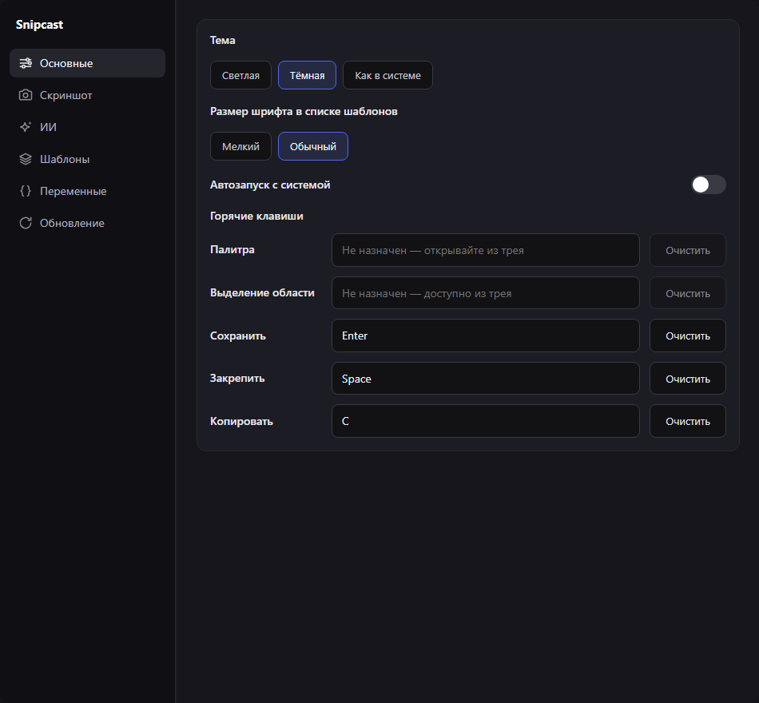
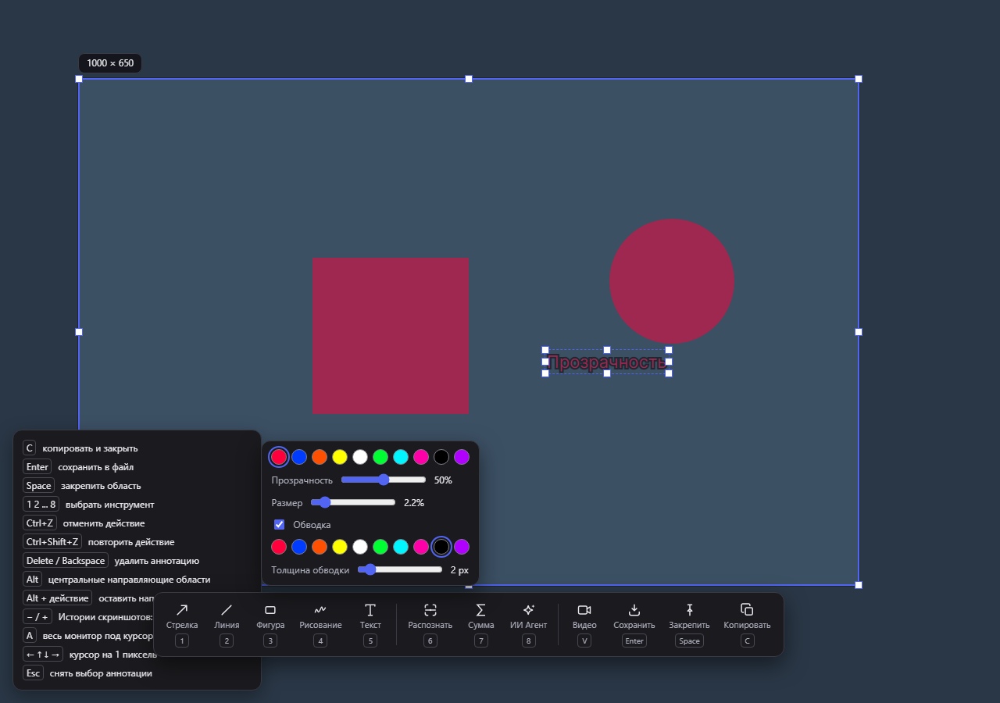

# Snipcast 0.36.8 — захват и аннотации

Изменения: возврат панели подсказок в левый нижний угол после ухода указателя из исходной зоны; подпись «Истории скриншотов: старее / новее»; перехват команд в активном захвате; режимы «Контур» / «Заливка»; прозрачность аннотаций; пять горячих клавиш в одном списке основных настроек.

## Область проверок

Выбор проверок ограничен изменениями этой задачи, через `test:changed --focus capture-editor --files ...`. Проверки записи и экспорта видео, миграции истории и Win+V не запускались. В нативном сценарии клавиша C должна вводить один символ в текстовое поле вместо запуска копирования скриншота. Тест не восстанавливает и не очищает буфер пользователя.

Интерфейс проверен в светлой и тёмной темах при 100/150/200% в браузерном стенде: возврат подсказок, точная подпись истории, выбор залитой фигуры за середину, прямоугольник и круг, прозрачность в PNG, переключение контура и заливки с отменой, текст с обводкой без накопления непрозрачности отдельных слоёв. В настройках проверены порядок всех пяти полей и выравнивание в одном блоке.

Перехват реализован через Windows API на отдельном потоке сообщений. Обработчик читает атомарные состояния окон мониторов и передаёт только нужные события в WebView2. Ввод текста сохраняет приоритет; диалог сохранения и потеря фокуса отключают обработку команд захвата. Библиотека WebView2 уже входила в зависимости Tauri; дополнительный внешний исполняемый компонент не требуется.

Для прозрачности применяется один переиспользуемый временный canvas размером по границам фигуры. Старые аннотации без свойства прозрачности остаются полностью непрозрачными, старые фигуры — контурными.

## Ограничения

100/150/200% — браузерная проверка рендеринга; нативный прогон выполняется при текущем масштабе Windows. Физическую конфигурацию нескольких мониторов и аппаратный IME в этой задаче не меняли. Перехват обычных горячих клавиш не означает приоритет над защищёнными системными сочетаниями, драйверами клавиатуры или произвольным другим перехватчиком, установленным позднее.

## Итог проверки

- **PASS:** 8 интерфейсных сценариев (6 сочетаний темы и масштаба, настройки в обеих темах).
- **PASS:** 3 целевых Rust-теста правил перехвата, включая дополнительные Alt-комбинации, переназначение, NumPad и пропуск чужих клавиш; 27 остальных тестов отфильтрованы.
- **PASS:** обычная сборка `tauri build --no-bundle`, версия EXE 0.36.8, основной идентификатор приложения; тестовый идентификатор отсутствует.
- **Отложено:** итоговая нативная приёмка. Отдельные предварительные прогоны C и Ctrl+F9 прошли, Ctrl+Alt+F7 сработал в диагностическом прогоне. Повторные прогоны были нестабильны; окончательный прогон перенесён по просьбе пользователя. Полный набор нативных сценариев не заявляется пройденным.

Во время проверки через IPC Windows иногда поглощает первый клик для активации окна. Стенд отдельно активирует окно перед выделением и ожидает конкретный новый снимок, а не прежнюю прогретую страницу. Сочетания отправляются одним пакетом SendInput; это исключает вклинивание других событий между нажатиями модификаторов и клавиши команды. [Документация Microsoft](https://learn.microsoft.com/en-us/windows/win32/api/winuser/nf-winuser-sendinput).

В коде перехвата используется NULL-дескриптор модуля и отдельный поток сообщений; состояние левого и правого модификаторов отслеживается отдельно, поскольку Windows обновляет асинхронное состояние после вызова обработчика. Диагностические счётчики и запись событий удалены из выпуска. [LowLevelKeyboardProc](https://learn.microsoft.com/en-us/windows/win32/winmsg/lowlevelkeyboardproc).

Подтверждения: [интерфейсные результаты](qa-artifacts/capture-editor-0368/ui-results.json), [Rust](qa-artifacts/capture-editor-0368/rust.log), [сборка](qa-artifacts/capture-editor-0368/build.log), [статус нативной проверки](qa-artifacts/capture-editor-0368/native-status.json), [EXE и SHA-256](qa-artifacts/capture-editor-0368/release.json).

## Подготовка и очистка

В `dist-release/` оставлены только `snipcast.exe` 0.36.8 и `snipcast.exe.sha256`. SHA-256: `659c381dac6089afb6269ef029696aa6ccdc7a689c99342029898256d67e8333`. EXE — 17 756 672 байта.

Предыдущий экземпляр был без видимых рабочих окон и штатно закрыт через команду выхода. Последняя версия запущена из `dist-release/snipcast.exe`; проверены путь, версия 0.36.8, PID 90268 и готовность значка в трее. [Подтверждение запуска](qa-artifacts/capture-editor-0368/launched.json).

Cargo очищен целиком; удалены `.qa-work/`, оба локальных кэша Vite и изолированный профиль WebView2 этого прогона. Удалено 2 508 735 966 байт промежуточных файлов (около 2,5 ГБ). Пользовательские данные, история и зависимости сохранены. [Проверка очистки](qa-artifacts/capture-editor-0368/cleanup.json).

Публикация на GitHub не выполнялась. Окончательный нативный прогон выполнить отдельно, в удобный пользователю момент, в изолированном экземпляре Snipcast.
